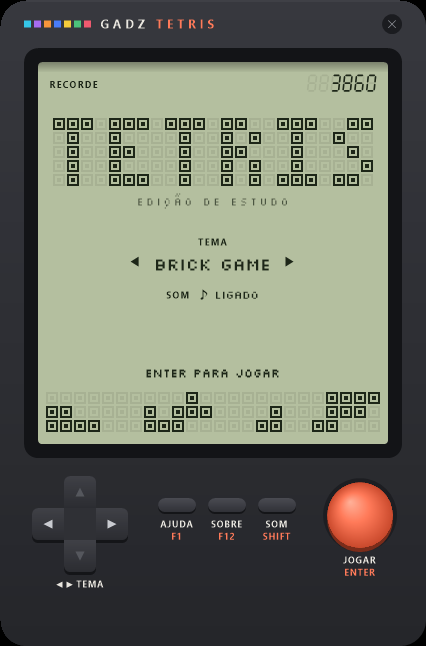
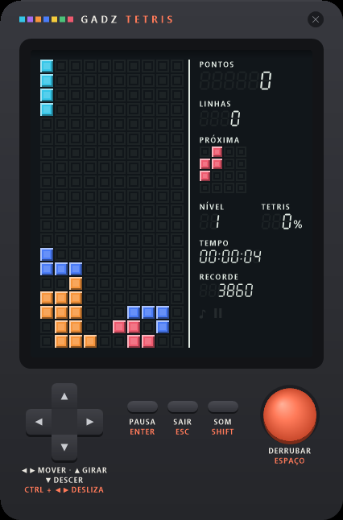
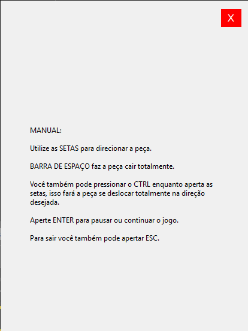
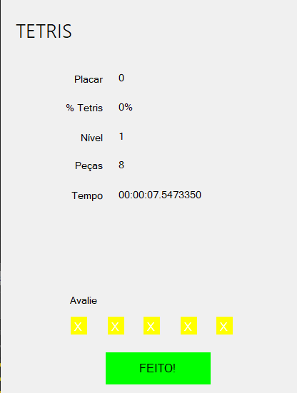

# Tetris


[](https://phduarte.github.io/Tetris/)
[](https://www.codefactor.io/repository/github/phduarte/tetris)
[](https://www.codacy.com/manual/phduarte87/Tetris?utm_source=github.com&amp;utm_medium=referral&amp;utm_content=phduarte/Tetris&amp;utm_campaign=Badge_Grade)

*[Read this in English](README.en.md)*

### [▶ Jogar no navegador](https://phduarte.github.io/Tetris/)

O jogo é uma aplicação web **PWA** (Blazor WebAssembly): roda no navegador do computador ou do celular, sem instalar nada e sem servidor, e pode ser instalado como aplicativo pelo próprio navegador. Também há uma versão **Desktop** para Windows, em WinForms. As duas interfaces usam o mesmo domínio, com as mesmas regras.

Tetris é um jogo comercializado pela Nintendo em 1989 e um dos jogos de vídeo-game mais famosos de todos os tempos.

Essa versão foi inicialmente inspirada nos brick-games e foi desenvolvido com propósito único de estudo e prática das disciplinas de Engenharia de Software.

O projeto utiliza o jogo Tetris como cenário justamente por ser muito conhecido, o que facilita a correlação das regras no mundo real com os códigos que aqui são escritos.

## História

Em 1984, no Centro de Computação da Academia de Ciências Soviética, o matemático russo Alexey Pajintov estudava uma teoria de análise combinatória dos pentaminós de Solomon Golomb. Os pentaminós eram peças compostas por cinco blocos, que poderiam alterar sua forma para combinarem entre si. Pajintov criou sua versão simplificada da teoria criando peças de 4 blocos, os tetraminós. 

Em junho de 1984, ele adaptou sua teoria para um jogo que se tornou rapidamente muito popular e posteriormente descoberto pelo inglês Robert Stein, quem o trouxe para o ocidente onde despertou interesse da Nintendo.

Ao longo dos anos a distribuição desse jogo se tornou objeto de disputas judiciais complexas que envolviam três países e as principais fabricantes de jogos da época, no entanto, a Nintendo conseguiu ganhar a briga e tornou o Tetris o seu jogo de lançamento do Game Boy em 1989, no lugar do principal mascote da casa, Mario.

A versão do Gameboy vendeu 70 milhões de cópias e o jogo entrou para o Guiness Book por ter sido o mais portado da história, sendo distribuído em 65 plataformas diferentes.

Por ter sido desenvolvido em uma estatal russa por um cidadão russo, os diretos pela comercialização do jogo foram retidos pelo Estado durante 10 anos, e Alexey só passou receber royalties à partir de 1996.

...

Um fato curioso é que Steve Wozniak, cofundador da Apple foi um dos maiores recordistas do jogo e enviada suas pontuações para a revista Nintendo Power. Ele passou a ser barrado pela revista depos de um tempo, mas continuou mandando seus recordes usando um nome falso, Evets Kainzow, que significa Steve Wozniak ao contrário.

## Arquitetura

  O propósito deste projeto é simplificar a aplicação das métodologias, padrões e princípios em destaque atualmente. Toda implementação leva em consideração as boas práticas do Clean Code, Design Patterns e princípios como SOLID, mas com a preocupação de se evitar o over-engineering. Então mesmo que algum padrão possa ser aplicado, ainda será avaliado seu custo benefício. O projeto sempre estará aberto a refatoração.

  A Solution começou com apenas dois pacotes, o Core e o Desktop. Com as refatorações ela foi separada em camadas, usando .NET 10:

```
Web ──► Application ──► Domain
   └──► Texts

Desktop ──► Application ──► Domain
   ├──► Data ──► Domain
   ├──► SoundPlayer ──► Application
   └──► Texts
```

| Projeto | Responsabilidade |
| --- | --- |
| `Gadz.Tetris.Domain` | Modelo de domínio e todas as regras do jogo (tabuleiro, peças, colisão, pontuação, níveis, recorde e estados). Não depende de nenhum outro projeto. |
| `Gadz.Tetris.Data` | Repositório das estatísticas, gravadas em `%USERPROFILE%\Tetris\stats.mc`. |
| `Gadz.Tetris.SoundPlayer` | Adapter de áudio sobre a `winmm.dll`, que implementa o `ISoundPlayer` da `Application`. |
| `Gadz.Tetris.Texts` | Textos da interface em inglês e português, compartilhados entre as interfaces. |
| `Gadz.Tetris.Application` | `GameController` (fachada para as interfaces) e os comandos de teclado. Depende só do domínio: recebe o repositório e o som de quem a usa. |
| `Gadz.Tetris.Web` | Interface Blazor WebAssembly (PWA) para navegador e celular. O jogo inteiro (domínio e aplicação) roda no próprio navegador, sem servidor. As estatísticas ficam no `localStorage` e os sons tocam pela Web Audio API. Não tem regras de jogo. |
| `Gadz.Tetris.Desktop` | Interface WinForms para Windows: o mesmo aparelho da Web, numa janela. Não tem regras de jogo. É a raiz de composição: cria o repositório em arquivo e o som do Windows no `Program.cs`. |
| `Gadz.Tetris.Tests` | Testes NUnit do domínio e do `GameController`. |

  Enquanto eu modelava o Modelo de Domínio, a neutralidade tecnológica e o desacoplamento das responsabilidades foi algo fundamental, por isso o Domínio não tem ligações externas com camadas de Infraestrutura ou Interface por exemplo. Afinal, não podemos permitir que regras do jogo sejam manipuladas pelo usuário, e nem ficar preso num modelo de Interface só. Foi essa separação que permitiu levar o jogo, que nasceu no Windows, para o navegador e o celular reaproveitando o mesmo domínio. Dentro de cada projeto, o que não precisa ser visto de fora fica isolado com os modificadores *internal* e *private*.

Os planos de evolução estão em [docs/PLANO-REFATORACAO.md](docs/PLANO-REFATORACAO.md) e [docs/PLANO-MULTIPLATAFORMA.md](docs/PLANO-MULTIPLATAFORMA.md).

## Como rodar

É preciso ter o [SDK do .NET 10](https://dotnet.microsoft.com/download) (a versão fica fixada no `global.json`).

```sh
dotnet build Gadz.Tetris.sln
dotnet test Gadz.Tetris.sln
```

### Web (navegador)

```sh
dotnet run --project Gadz.Tetris.Web
```

Depois abra http://localhost:5156 no navegador (o endereço também aparece no terminal). Para usar HTTPS, rode com `--launch-profile https` e abra https://localhost:7231. Os perfis ficam em `Gadz.Tetris.Web/Properties/launchSettings.json`.

- Roda em qualquer sistema operacional com o SDK, e o jogo abre em navegadores atuais.
- O idioma segue o do navegador: português para `pt`, inglês para os demais.
- O recorde, o histórico, o tema e o som ligado/desligado ficam guardados no navegador. Limpar os dados do site zera tudo.
- O navegador só libera o som depois do primeiro toque ou tecla: os sons começam junto com a primeira ação.
- No navegador, a tela Sobre abre com **F2**, porque o F12 abre as ferramentas do desenvolvedor.

Para gerar os arquivos estáticos (que podem ser servidos por qualquer servidor web, sem .NET):

```sh
dotnet publish Gadz.Tetris.Web -c Release -o publish
```

O site fica em `publish/wwwroot`.

A versão online é publicada no [GitHub Pages](https://phduarte.github.io/Tetris/) pelo workflow `.github/workflows/pages.yml`, a cada push na `main`. Como o site fica na subpasta `/Tetris/`, o workflow ajusta o `<base href>` do `index.html` antes do `publish`.

### Desktop (Windows)

```sh
dotnet run --project Gadz.Tetris.Desktop
```

A interface WinForms e o som (`winmm.dll`) só funcionam no Windows.

No VS Code, o `.vscode/launch.json` traz as opções **Web (Blazor WebAssembly)** e **Desktop (WinForms)** para rodar e depurar com F5.

## Características

- **No navegador e no celular**: o jogo abre direto pelo link, se ajusta à tela do celular e pode ser instalado como aplicativo (PWA). No Windows, também há a versão Desktop.
- **Um aparelho, várias telas**: o jogo é um minigame de bolso (carcaça grafite e coral) em que só o LCD muda de uma tela para outra. Os botões da carcaça mostram a ação e a tecla, e também podem ser clicados.
- **Estilo BRICK GAME**: LCD esverdeado e monocromático, como o video-game de bolso famoso na década de 90.
- **Estilo TETRIS**: LCD escuro com as peças nas cores do jogo original da década de 80. O tema é escolhido no menu com ← / →.
- **Pausa e fim de jogo no LCD**: na pausa (inclusive a automática, quando a janela perde o foco) o tabuleiro apaga para não espiar a jogada. Ao perder, uma cortina de blocos sobe e desce antes do GAME OVER, que segue para o resultado com qualquer tecla ou sozinho 5 segundos depois de a música de fim terminar.
- **Resultado**: pontos, nível, linhas, peças, % de TETRIS e tempo, com o selo NOVO RECORDE quando a partida supera o recorde guardado. Volta ao menu com ENTER ou sozinho depois de 15 segundos.
- **Ajuda interativa**: apertar uma tecla destaca a linha dela no manual, que também traz a tabela de pontos.
- **Idiomas**: textos em inglês e em português, conforme o idioma do navegador (ou do Windows, no Desktop).
- **Slide**: Segurar a tecla CTRL enquanto move a peça para esquerda ou direita faz a peça deslizar até o limite.
- **Smash Down**: Ao apertar a tecla SPACEBAR a peça imediatamente cai em velocidade acelerada.
- **Sons**: Os eventos e movimentos reproduzem sons similares aos dos brickgames.
- **Sound On/Off**: Opção para ligar ou desligar sons na tela inicial ou durante o jogo pressionando a tecla SHIFT.
- **Pontuação**:
  + 1 linha completa vale 40 pontos
  + 2 linhas completas na mesma jogada valem 100 pontos
  + 3 linhas completas na mesma jogada valem 300 pontos
  + TETRIS (4 linhas completas na mesma jogada) vale 1.200 pontos
- **Níveis e velocidade**: o nível sobe ao completar a meta de linhas (20 no primeiro nível, crescendo 25% a cada nível). No nível 1 a peça desce a cada 1.000 ms, e esse intervalo diminui 50 ms por nível até o mínimo de 100 ms.
- **HI-SCORE**: o menu e a tela de jogo mostram o recorde. Ele é a maior pontuação já guardada (partidas encerradas com ESC ou perdidas) e passa a acompanhar a pontuação atual quando ela o supera.

## Controles

| Tecla | Ação |
| --- | --- |
| ← / → | Move a peça (segurando a tecla, ela anda 2 blocos a cada repetição) |
| CTRL + ← / → | Desliza a peça até o limite |
| ↓ | Desce a peça |
| ↑ | Gira a peça |
| ESPAÇO | Derruba a peça (smash down) |
| ENTER | Pausa / continua |
| ESC | Encerra o jogo e salva as estatísticas |
| SHIFT | Liga / desliga o som (com o som desligado, o botão SOM fica afundado) |
| F1 | Abre a ajuda (no menu) |
| F12 | Abre a tela Sobre (no menu; na Web é F2) |

## Gráfico

| Menu | Partida | Ajuda | Resultado |
| --- | --- | --- | --- |
|  |  |  |  |

Os mockups e as decisões do redesign estão em [docs/redesign.html](docs/redesign.html), e o fluxo entre as telas em [docs/jornada.html](docs/jornada.html).

## Conclusão

Quando desenvolvi esse jogo tive como meta não procurar outros projetos como exemplo. 
Procurei apenas informações sobre as regras e termos. Eu queria fazê-lo por completo sem auxílio técnico, desse modo eu acreditava que poderia tornar meu estudo mais neutro, podendo chegar numa conclusão embasada na teoria e na minha prática, não influenciada.

Na sequência vou destacar minha conclusão em cada um dos campos de estudo.

### Domain-Driven Design

Apesar de ser um contexto relativamente pequeno, o uso de DDD me ajudou criar um modelo de domínio conciso. O desenvolvimento partiu todo dele, o entendimento das regras, à quem elas pertenciam, quais eram realmente as entidades do domínio, como elas se relacionavam, onde e quando deveria ser implementadas as regras, o sistema cresceu ao redor do domínio, e isso me permitiu fazê-lo em duas semanas. Porque não houve um momento onde me questionei se estava fazendo certo ou se havia esquecido de algo. O domínio me pareceu maduro e me apoiou ao longo do desenvolvimento. 

Também percebi bastante segurança ao longo do desenvolvimento graças à tentativa desde o início de adotar a linguagem ubíqua, isso me ajudou entender melhor o problema e aprender durante o desenvolvimento, a clareza da linguagem me permitiu elaborar melhores perguntas e me sentir mais preparado para entender as respostas e replicar enquanto não desse liga.

### Windows Forms

A escolha de uma tecnologia não tão popular atualmente foi proposital, justamente para servir como uma base para versões futuras de diferentes interfaces gráficas.

Essa versão deveria ser concluída rápido, o Windows Forms ajudou por permitir trabalhar facilmente com callbacks através de Eventos e delegates.

O projeto ficou bem leve e pequeno para download, graças às várias bibliotecas que já vêm embutidas no .NET.

Depois, a interface principal passou a ser a Web (Blazor WebAssembly), e o WinForms continua como a versão Desktop. Como as regras estavam todas no domínio, a nova interface só precisou desenhar o aparelho e trocar a infraestrutura (arquivo e `winmm.dll` por `localStorage` e Web Audio).

### Clean Code

Depois que terminei a primeira versão, achei vários exemplos de outras implementações desenvolvidas com projetos mais simples. 

Em geral, a lógica de solução me pareceu semelhante, porém, alguns desses projetos me pareceram mais difíceis de dar manutenção. 
Alguns estavam escritos em apenas uma classe ou método, você pode não se assustar quando vê a estrutura, mas acaba assustando quando abre esse arquivo.
Muitos abusavam de desvios condicionais e loops, gerando uma complexidade ciclomática muito alta. 
O uso de números mágicos e comentários também foram coisas que não quis fazer aqui.

No final a minha impressão é que colocar tudo junto num arquivo só é mais fácil e rápido quando está criando, em contra partida separar em uma estrutura legível dará mais trabalho e demorará mais, porém, esse esforço e tempo inverte após o projeto ser concluído e passa a ser mantido. Então se a manutenção do seu sistema for algo mais importante ou representar a maior parte do ciclo de vida da aplicação, o uso de um estilo arquitetural em camadas e principalmente com uma ênfase em Domínio do problema, é uma escolha normalmente mais eficiente.

### SOLID

No final minha conclusão foi que usar princípios SOLID nesse projeto o deixou mais fácil de manter e evoluir do que os outros que vi e que pareciam mais eficientes por conter menos arquivos ou métodos.

Na aplicação cliente, eu implementei o padrão command para permitir extensão de comandos respeitando OCP do SOLID.

### Design Patterns

Usei por exemplo o padrão State para garantir por exemplo, que um jogo em andamento pode ser pausado e continuado.

Também foi usado o padrão Builder para tornar a construção de uma peça mais dinâmica em tempo de execução.

Para montagem dos tetraminós usei o padrão Strategy, pois o formato de cada peça é diferente em cada rotação e isso é definido em tempo de execução. Cada tetraminó declara suas formas como uma tabela de posições, e a classe base monta os blocos a partir dela.

Para persistência dos dados usei o padrão Repository, onde eu tenho um interface no Modelo de Domínio e uma implementação fora dele. No meu caso aqui a implementação é quase um Mock para salvar em formato flat no disco local, mas poderia facimente ser extendido para um modelo em núvem por exemplo.

Na aplicação cliente, cada ação de teclado é um Command registrado numa fábrica, o que permite novos comandos sem alterar os formulários.

## Links úteis

- [Jogar no navegador](https://phduarte.github.io/Tetris/)
- [Baixar a versão Desktop (Windows)](https://github.com/phduarte/Tetris/releases/latest)
- [Documentação](https://github.com/phduarte/Tetris/wiki)


## Bibliografia

- https://www.historiadomundo.com.br/idade-contemporanea/origem-do-tetris.htm#:~:text=Considerado%20um%20verdadeiro%20cl%C3%A1ssico%20dos,matem%C3%A1tico%20norte%2Damericano%20Solomon%20Golomb.
- https://tecnoblog.net/meiobit/289280/tetris-30-anos-a-historia/
